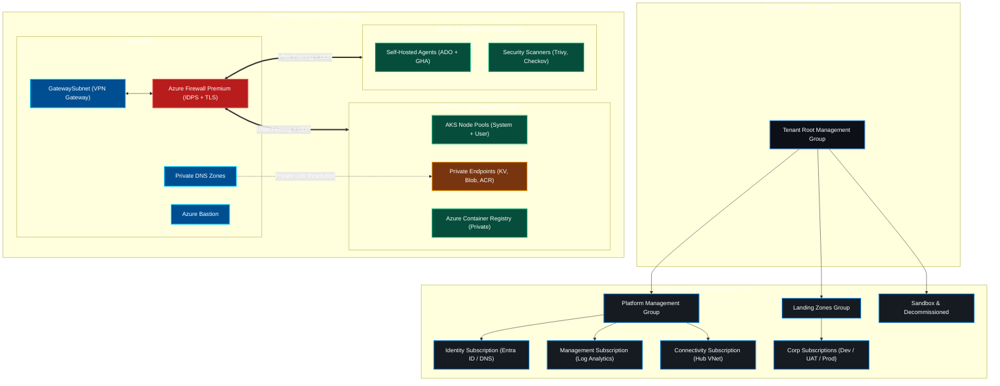

<div align="center">

<!-- Hero Dynamic Waving Banner -->


<!-- Dynamic Animated Typing Subtitle -->
<a href="https://github.com/Kverma0089">
  
</a>

<br />

<!-- Quick Navigation Bar -->
<p align="center">
  <a href="#about"><b>About</b></a> •
  <a href="#impact"><b>Impact</b></a> •
  <a href="#blueprints"><b>Blueprints</b></a> •
  <a href="#arsenal"><b>Arsenal</b></a> •
  <a href="#certs"><b>Certifications</b></a> •
  <a href="#projects"><b>Projects</b></a> •
  <a href="#telemetry"><b>Stats</b></a> •
  <a href="#connect"><b>Connect</b></a>
</p>

<!-- Live Badges & Counters -->
<p align="center">
  <a href="https://komarev.com/ghpvc/?username=Kverma0089&style=for-the-badge&color=0078d4">
    
  </a>
  <a href="https://www.linkedin.com/in/kshitij-verma/">
    
  </a>
  
  
  
</p>

---

</div>

<a name="about"></a>
## 💻 Engineer Terminal

```bash
┌──(kshitij㉿azure-cloud)-[~/platform-engineering]
└─$ ./launch-cloud-inspection.sh --env production --mode full-audit

[✔] Microsoft Entra ID & RBAC Guardrails         : ACTIVE (Zero-Trust Enforced)
[✔] Azure Hub-and-Spoke Topology                  : ONLINE (Azure Firewall + NSG Active)
[✔] Terraform IaC State                           : ZERO DRIFT (Remote State on Azure Blob)
[✔] Shift-Left DevSecOps Gates                    : Checkov, Trivy, Gitleaks PASS (0 Criticals)
[✔] AKS Cluster Health                            : HEALTHY (Node Pools Autoscaling Active)
[✔] GitOps Engine (ArgoCD)                        : SYNCED (All Apps Green)
[✔] Monitoring Stack (Grafana + Prometheus)       : ONLINE (All Dashboards Active)
[✔] Target Availability                           : 99.9% | Multi-Region DR Configured
```

> *"Automate everything. Enforce Zero-Trust by default. Shift security left. And deliver infrastructure as reliable, versioned, auditable code."*

I am an **Azure Cloud & DevOps Engineer** specialising in **Infrastructure as Code, Kubernetes Platform Engineering, CI/CD Automation, and Cloud Security**. I design and operate production-grade cloud platforms on Microsoft Azure — from Landing Zone architecture to multi-cluster AKS deployments managed via GitOps.

My expertise spans the full DevOps lifecycle: provisioning infrastructure with Terraform, automating multi-stage pipelines with Azure DevOps and GitHub Actions, enforcing security with Policy-as-Code, and building observability stacks with Grafana and Prometheus.

---

<a name="impact"></a>
## ⚡ Quantified Impact & Scale

<div align="center">

| Metric | Scale | Impact |
| :--- | :--- | :--- |
| 🏗️ **IaC Coverage** | **100% Terraform Governed** | All environments provisioned via modular Terraform with remote state, drift detection, and semantic versioning — zero manual click-ops. |
| 🐳 **Kubernetes Workloads** | **AKS Multi-Cluster** | Designed and managed AKS clusters with KEDA autoscaling, Workload Identity, OPA Gatekeeper, and ArgoCD GitOps — zero unplanned downtime. |
| 🛡️ **Shift-Left Security** | **Pre-Prod Gate Enforcement** | Embedded Checkov, Trivy, and Gitleaks into all PR pipelines — blocking vulnerabilities before they reach production environments. |
| 🔄 **CI/CD Automation** | **End-to-End Pipelines** | Built multi-stage Azure DevOps and GitHub Actions pipelines with Blue/Green deployments, rollback automation, and environment protection gates. |
| 📊 **Observability** | **Full Stack Monitoring** | Deployed Grafana + Prometheus + Azure Monitor stacks with custom dashboards, alerting, and Log Analytics Workspace integration. |
| 📜 **Certifications** | **8 Active Credentials** | AZ-104, AZ-305, AZ-400 (Expert), CKA, Terraform Associate, SC-900, AZ-900, GitHub Actions — active and validated. |

</div>

---

<a name="blueprints"></a>
## 🏛️ Architecture Blueprints

### 1. Enterprise Azure Landing Zone — Hub-and-Spoke Topology



---

### 2. Shift-Left DevSecOps CI/CD Pipeline

```mermaid
flowchart LR
    classDef trigger fill:#1E293B,stroke:#64748B,stroke-width:2px,color:#fff;
    classDef stage fill:#0F172A,stroke:#0284C7,stroke-width:2px,color:#fff;
    classDef sec fill:#450A0A,stroke:#DC2626,stroke-width:2px,color:#fff;
    classDef deploy fill:#0C4A6E,stroke:#0284C7,stroke-width:2px,color:#fff;
    classDef gate fill:#581C87,stroke:#9333EA,stroke-width:2px,color:#fff;

    DEV(["Developer Commit"]):::trigger --> PR["Pull Request Trigger"]:::trigger

    subgraph Stage1[" Stage 1: Validate & Lint "]
        LINT["tflint + terraform fmt"]:::stage
        VALIDATE["terraform validate"]:::stage
    end

    subgraph Stage2[" Stage 2: Shift-Left Security "]
        SECRETS["Secret Scanning (Gitleaks)"]:::sec
        SAST["IaC Scan (Checkov + Trivy)"]:::sec
        POLICY["Policy Gate (OPA + Azure Policy)"]:::sec
    end

    subgraph Stage3[" Stage 3: Plan & Review "]
        PLAN["terraform plan (Remote State Lock)"]:::stage
        COMMENT["PR Cost Comment (Infracost)"]:::stage
    end

    subgraph Stage4[" Stage 4: Deploy (Main Branch) "]
        APPLY["terraform apply --auto-approve"]:::deploy
        ARGO["ArgoCD Sync (GitOps)"]:::deploy
    end

    subgraph Stage5[" Stage 5: Post-Deploy Verify "]
        SMOKE["Smoke Tests + Health Checks"]:::gate
        DRIFT["Drift Detection (Scheduled)"]:::gate
    end

    PR --> Stage1 --> Stage2 --> Stage3 --> Stage4 --> Stage5
```



---

<a name="arsenal"></a>
## 🛠️ Tech Arsenal

### ☁️ Azure Cloud
<p align="center">


</p>

### 🏗️ Infrastructure as Code
<p align="center">


</p>

### 🐳 Containers & GitOps
<p align="center">


</p>

### 🔄 CI/CD & DevSecOps
<p align="center">


</p>

### 📊 Monitoring & Observability
<p align="center">


</p>

### 💻 Scripting & Languages
<p align="center">


</p>

---

<a name="certs"></a>
## 📜 Certification Wall

<div align="center">

| Certification | Issuer | Level | Year |
| :--- | :--- | :---: | :---: |
| **AZ-900** Azure Fundamentals | Microsoft | Associate | 2022 |
| **AZ-104** Azure Administrator Associate | Microsoft | Associate | 2022 |
| **SC-900** Security, Compliance & Identity | Microsoft | Fundamentals | 2022 |
| **AZ-400** Azure DevOps Engineer Expert | Microsoft | **Expert** | 2023 |
| **AZ-305** Azure Solutions Architect Expert | Microsoft | **Expert** | 2023 |
| **CKA** Certified Kubernetes Administrator | CNCF | Professional | 2023 |
| **Terraform Associate 003** | HashiCorp | Associate | 2024 |
| **GitHub Actions** Certification | GitHub | Associate | 2024 |

</div>

---

<a name="projects"></a>
## 🌟 Featured Projects

<div align="center">

[](https://github.com/Kverma0089/kshitij-cloud-portfolio)

</div>

---

<a name="telemetry"></a>
## 📊 GitHub Telemetry

<div align="center">
  
  
</div>
<div align="center">
  
</div>
<div align="center">
  
</div>
<div align="center">
  
</div>

---

<a name="connect"></a>
## 💬 Connect

<div align="center">

<a href="https://www.linkedin.com/in/kshitij-verma/">
  
</a>
<a href="https://github.com/Kverma0089">
  
</a>
<a href="https://kverma0089.github.io/kshitij-cloud-portfolio">
  
</a>

<br /><br />


</div>
